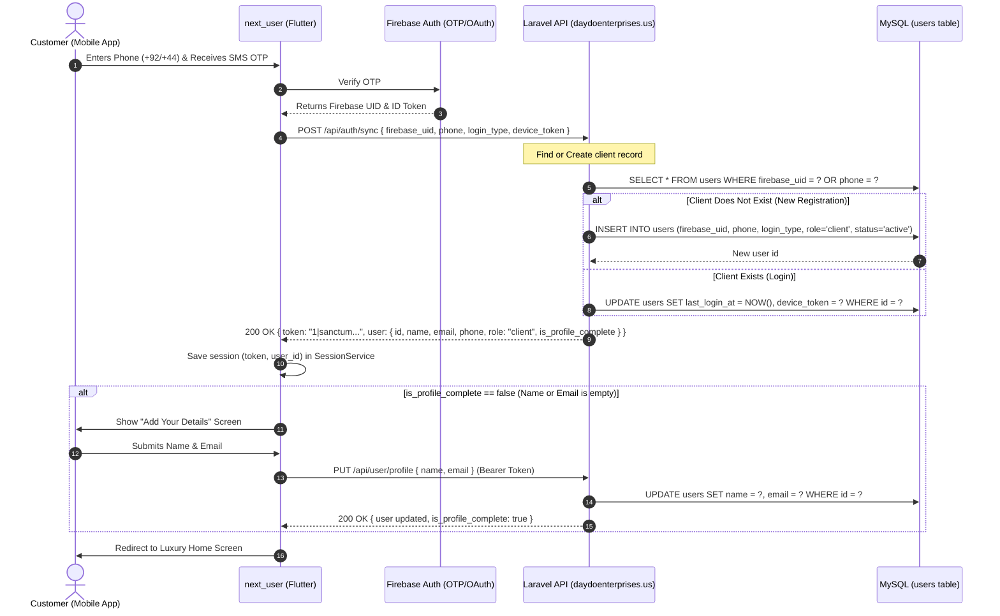

# 🚀 Backend Integration & Database Guide — Client Auth Sync (Laravel)

**Application:** Next User — Mobile Concierge & Client Moving App  
**Companion App:** `next_gen` (Staff, Surveyor & Driver Mobile App)  
**Backend Framework:** **Laravel (PHP)** with Laravel Sanctum  
**Live Production Host:** `https://daydoenterprises.us`  
**Base API Endpoint:** `https://daydoenterprises.us/api`  
**Database:** MySQL / MariaDB (shared `users` table with `role = 'client'`)  

---

## 1. Architecture Overview (Aligned with `next_gen`)

In this ecosystem:
* `next_gen` handles **staff members** (`role = 'surveyor'`, `role = 'driver'`) who log in using email/password.
* `next_user` handles **end-clients / customers** (`role = 'client'`) who use modern **passwordless authentication** (Phone SMS OTP, Google OAuth, Apple Sign-In) through Firebase.
* Once Firebase verifies the user's phone or OAuth credential, the Flutter app calls the Laravel API:  
  `POST https://daydoenterprises.us/api/auth/sync`
* The Laravel backend executes a **"Find or Create"** check in the shared `users` table:
  * If the client exists $\rightarrow$ Returns their record & Sanctum Bearer token.
  * If the client is new $\rightarrow$ Creates a new record with `role = 'client'`, generates a Sanctum Bearer token, and flags `is_profile_complete: false` so the app prompts them for their Name & Email.



---

## 2. Database Migration for Laravel (`users` table)

Since `next_gen` already uses the `users` table on `daydoenterprises.us`, create a new migration to add the necessary columns for `next_user` client sync:

### Migration: `database/migrations/xxxx_xx_xx_add_firebase_and_client_fields_to_users_table.php`

```php
<?php

use Illuminate\Database\Migrations\Migration;
use Illuminate\Database\Schema\Blueprint;
use Illuminate\Support\Facades\Schema;

return new class extends Migration
{
    public function up(): void
    {
        Schema::table('users', function (Blueprint $table) {
            // Firebase UID for cross-platform identity linking
            if (!Schema::hasColumn('users', 'firebase_uid')) {
                $table->string('firebase_uid', 128)->nullable()->unique()->after('id');
            }

            // Client registration type: 'phone', 'email', 'google', 'apple'
            if (!Schema::hasColumn('users', 'login_type')) {
                $table->string('login_type', 30)->default('email')->after('firebase_uid');
            }

            // Phone number with country code (e.g. +923001234567 or +447911123456)
            if (!Schema::hasColumn('users', 'phone')) {
                $table->string('phone', 30)->nullable()->unique()->after('email');
            }

            // Flag if phone was verified via SMS OTP
            if (!Schema::hasColumn('users', 'phone_verified')) {
                $table->boolean('phone_verified')->default(false)->after('phone');
            }

            // Device token for FCM push notifications
            if (!Schema::hasColumn('users', 'device_token')) {
                $table->text('device_token')->nullable()->after('remember_token');
            }

            // Account status
            if (!Schema::hasColumn('users', 'status')) {
                $table->string('status', 20)->default('active')->after('device_token');
            }

            // Last login timestamp
            if (!Schema::hasColumn('users', 'last_login_at')) {
                $table->timestamp('last_login_at')->nullable()->after('updated_at');
            }
        });
    }

    public function down(): void
    {
        Schema::table('users', function (Blueprint $table) {
            $table->dropColumn([
                'firebase_uid',
                'login_type',
                'phone',
                'phone_verified',
                'device_token',
                'status',
                'last_login_at',
            ]);
        });
    }
};
```

---

## 3. Laravel API Routes (`routes/api.php`)

Add the following routes to your Laravel `routes/api.php` file:

```php
use App\Http\Controllers\Api\ClientAuthController;
use App\Http\Controllers\Api\UserProfileController;

// Public client authentication sync endpoint
Route::post('/auth/sync', [ClientAuthController::class, 'sync']);

// Protected user routes (Requires Bearer Sanctum Token)
Route::middleware('auth:sanctum')->group(function () {
    Route::get('/user/profile', [UserProfileController::class, 'getProfile']);
    Route::put('/user/profile', [UserProfileController::class, 'updateProfile']);
    Route::post('/user/fcm-token', [UserProfileController::class, 'updateFcmToken']);
});
```

---

## 4. Laravel Controller Implementation

### Controller 1: `App\Http\Controllers\Api\ClientAuthController.php`

```php
<?php

namespace App\Http\Controllers\Api;

use App\Http\Controllers\Controller;
use App\Models\User;
use Illuminate\Http\Request;
use Illuminate\Support\Facades\Validator;
use Carbon\Carbon;

class ClientAuthController extends Controller
{
    /**
     * Find or create client account on mobile authentication sync
     * POST /api/auth/sync
     */
    public function sync(Request $request)
    {
        $validator = Validator::make($request->all(), [
            'firebase_uid'  => 'required|string|max:128',
            'login_type'    => 'required|string|in:phone,email,google,apple',
            'phone'         => 'nullable|string|max:30',
            'email'         => 'nullable|email|max:150',
            'name'          => 'nullable|string|max:150',
            'device_token'  => 'nullable|string',
        ]);

        if ($validator->fails()) {
            return response()->json([
                'success' => false,
                'message' => 'Validation error',
                'errors'  => $validator->errors()
            ], 422);
        }

        $firebaseUid = $request->input('firebase_uid');
        $loginType   = $request->input('login_type');
        $phone       = $request->input('phone');
        $email       = $request->input('email');
        $name        = $request->input('name');
        $deviceToken = $request->input('device_token');

        // 1. Find user by firebase_uid, or fallback to phone / email
        $user = User::where('firebase_uid', $firebaseUid)->first();

        if (!$user && $phone) {
            $user = User::where('phone', $phone)->first();
        }

        if (!$user && $email) {
            $user = User::where('email', $email)->first();
        }

        if ($user) {
            // Existing user: Link firebase_uid if missing & update login metadata
            $updates = [
                'last_login_at' => Carbon::now(),
            ];

            if (!$user->firebase_uid) {
                $updates['firebase_uid'] = $firebaseUid;
            }
            if ($deviceToken) {
                $updates['device_token'] = $deviceToken;
            }
            if ($phone && !$user->phone) {
                $updates['phone'] = $phone;
                $updates['phone_verified'] = true;
            }
            if ($name && (empty($user->name) || $user->name === 'User')) {
                $updates['name'] = $name;
            }
            if ($email && empty($user->email)) {
                $updates['email'] = $email;
            }

            $user->update($updates);
        } else {
            // 2. New client: Insert record
            $user = User::create([
                'firebase_uid'   => $firebaseUid,
                'login_type'     => $loginType,
                'name'           => $name ?: null,
                'email'          => $email ?: null,
                'phone'          => $phone ?: null,
                'phone_verified' => $loginType === 'phone',
                'role'           => 'client', // Differentiates from 'driver' / 'surveyor'
                'status'         => 'active',
                'device_token'   => $deviceToken ?: null,
                'password'       => bcrypt(uniqid('client_', true)), // Safe randomized password
                'last_login_at'  => Carbon::now(),
            ]);
        }

        // 3. Check account status
        if ($user->status === 'suspended' || $user->status === 'banned') {
            return response()->json([
                'success' => false,
                'message' => 'Your account has been deactivated. Please contact support.',
            ], 403);
        }

        // 4. Generate Laravel Sanctum Bearer Token
        $token = $user->createToken('client-mobile-token')->plainTextToken;

        // 5. Check if profile requires completion (Name or Email is empty)
        $isProfileComplete = !empty(trim($user->name ?? '')) && !empty(trim($user->email ?? ''));

        return response()->json([
            'success' => true,
            'message' => 'Authentication synchronized successfully.',
            'token'   => $token,
            'user'    => [
                'id'                  => $user->id,
                'firebase_uid'        => $user->firebase_uid,
                'name'                => $user->name,
                'email'               => $user->email,
                'phone'               => $user->phone,
                'role'                => $user->role ?? 'client',
                'status'              => $user->status,
                'is_profile_complete' => $isProfileComplete,
                'created_at'          => $user->created_at,
            ],
        ], 200);
    }
}
```

---

### Controller 2: `App\Http\Controllers\Api\UserProfileController.php`

```php
<?php

namespace App\Http\Controllers\Api;

use App\Http\Controllers\Controller;
use Illuminate\Http\Request;
use Illuminate\Support\Facades\Validator;
use Illuminate\Validation\Rule;

class UserProfileController extends Controller
{
    /**
     * Get logged-in user profile
     * GET /api/user/profile
     */
    public function getProfile(Request $request)
    {
        $user = $request->user();

        $isProfileComplete = !empty(trim($user->name ?? '')) && !empty(trim($user->email ?? ''));

        return response()->json([
            'success' => true,
            'user' => [
                'id'                  => $user->id,
                'firebase_uid'        => $user->firebase_uid,
                'name'                => $user->name,
                'email'               => $user->email,
                'phone'               => $user->phone,
                'role'                => $user->role,
                'status'              => $user->status,
                'is_profile_complete' => $isProfileComplete,
                'created_at'          => $user->created_at,
            ]
        ], 200);
    }

    /**
     * Update user profile details (Name & Email)
     * PUT /api/user/profile
     */
    public function updateProfile(Request $request)
    {
        $user = $request->user();

        $validator = Validator::make($request->all(), [
            'name'  => 'required|string|max:150',
            'email' => [
                'required',
                'email',
                'max:150',
                Rule::unique('users', 'email')->ignore($user->id),
            ],
        ]);

        if ($validator->fails()) {
            return response()->json([
                'success' => false,
                'message' => 'Validation error',
                'errors'  => $validator->errors()
            ], 422);
        }

        $user->update([
            'name'  => trim($request->input('name')),
            'email' => strtolower(trim($request->input('email'))),
        ]);

        return response()->json([
            'success' => true,
            'message' => 'Profile updated successfully.',
            'user' => [
                'id'                  => $user->id,
                'name'                => $user->name,
                'email'               => $user->email,
                'phone'               => $user->phone,
                'role'                => $user->role,
                'is_profile_complete' => true,
            ]
        ], 200);
    }

    /**
     * Update device FCM push notification token
     * POST /api/user/fcm-token
     */
    public function updateFcmToken(Request $request)
    {
        $request->validate([
            'fcm_token' => 'required|string',
        ]);

        $user = $request->user();
        $user->update(['device_token' => $request->input('fcm_token')]);

        return response()->json([
            'success' => true,
            'message' => 'FCM token updated successfully.'
        ], 200);
    }
}
```

---

## 5. Mobile App API Call Contracts

### Request Payload (`POST https://daydoenterprises.us/api/auth/sync`):
```json
{
  "firebase_uid": "4xT9KqLpM0vZ8bXy3wR1",
  "login_type": "phone",
  "phone": "+923001234567",
  "device_token": "fcm_token_sample_here"
}
```

### Response Payload (New User without Name/Email):
```json
{
  "success": true,
  "message": "Authentication synchronized successfully.",
  "token": "15|v7R2a9XkLtQpMzW...",
  "user": {
    "id": 84,
    "firebase_uid": "4xT9KqLpM0vZ8bXy3wR1",
    "name": null,
    "email": null,
    "phone": "+923001234567",
    "role": "client",
    "status": "active",
    "is_profile_complete": false,
    "created_at": "2026-10-19T12:00:00.000000Z"
  }
}
```
*When `is_profile_complete` is `false`, `next_user` will show the **"Complete Profile"** screen to ask for Name and Email.*

### Request Payload (`PUT https://daydoenterprises.us/api/user/profile`):
```json
{
  "name": "Muhammad Ali",
  "email": "m.ali@example.com"
}
```

---

## 6. Summary for Backend Developer

1. Run the migration to add `firebase_uid`, `login_type`, `phone`, `phone_verified`, and `last_login_at` to the `users` table.
2. Ensure `role = 'client'` is used for all customers registering through `next_user` (to prevent conflicts with `surveyor` and `driver` roles from `next_gen`).
3. Add the two controllers (`ClientAuthController` and `UserProfileController`) and the routes in `routes/api.php`.
4. Return standard Laravel Sanctum tokens and JSON formats.
